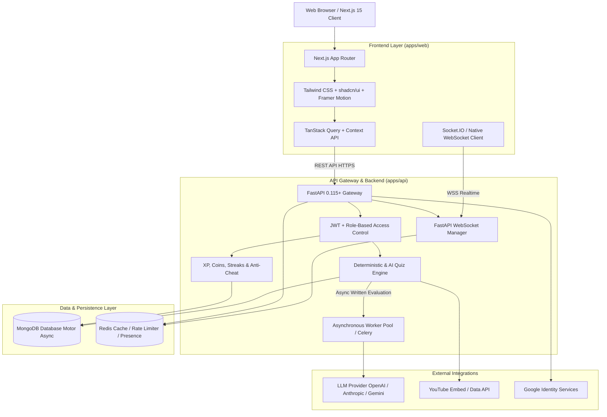

# QUIZORA — Architecture Specification
## AI-Powered Quiz, Learning, Gamification & Social Learning SaaS Platform

### 1. Executive Summary
QUIZORA is an enterprise-grade, high-performance, full-stack educational and competitive quiz platform. The platform harmonizes structured learning, real-time multiplayer competition, AI-driven evaluation and tutoring, daily habit reinforcement (discipline), and a gamified economy (XP, ranking coins, streaks, achievements, monthly tournaments).

---

### 2. High-Level System Architecture

---

### 3. Core Subsystems

#### 3.1. Quiz Lifecycle Engine (The 4-Stage Experience)
1. **Stage 1: Review Questions**
   - Read-only preview of selected question stems, topic metadata, and difficulty.
   - Prevents premature answer revelation.
   - User verifies readiness before timed lock-in.
2. **Stage 2: Curated Learning Video**
   - High-yield, topic-specific educational video (<= 5 min limit) embedded via YouTube official player or rich fallback concept summary.
   - Primer mechanism to maximize knowledge retention.
3. **Stage 3: Timed Active Assessment**
   - Synchronized server-side timer validation (1–30 min).
   - Real-time client state preservation with local autosave.
   - Anti-tampering verification: question options shuffled deterministically by attempt seed.
4. **Stage 4: Results, Explanations & Mistake Analytics**
   - Instant deterministic grading for Multiple Choice and True/False.
   - Asynchronous queuing for short written answers using semantic AI rubric evaluation.
   - Question-by-question post-mortem: correct answers, deep explanations, "why your answer was incorrect".
   - Direct integration with AI Assistant ("Ask AI About Mistakes").

#### 3.2. AI Service Architecture
- **Provider-Agnostic Abstraction Layer (`AIServiceInterface`):**
  - Adapters for OpenAI, Anthropic Claude, and Google Gemini with automatic graceful fallback when API keys are not supplied.
  - Development mock evaluation engine provides deterministic semantic grading based on lexical similarity, keyword coverage, and length heuristics.
- **Asynchronous Evaluation Pipeline:**
  - Fast quiz completion response with `EVALUATION_PENDING` status for written answers.
  - Background worker evaluates rubric, updates attempt score, re-aggregates user metrics, and notifies the client over WebSocket.
- **Interactive AI Tutor (`/api/v1/ai/chat`):**
  - System prompts primed with pedagogical guidelines: Socratic inquiry, error classification (conceptual misunderstanding vs calculation error), and tailored follow-up drills.

#### 3.3. Gamification & Tokenomics
- **Ranking Coins ($RC):**
  - Exact +10 $RC awarded strictly for 100% correct completed quizzes.
  - Idempotent transaction ledger (`ranking_transactions`) with unique `attempt_id` constraints to prevent double-spending or replay attacks.
- **Experience Points (XP) & Level Progression:**
  - Logarithmic level progression: $\text{Level} = \lfloor \sqrt{\text{XP} / 100} \rfloor + 1$.
  - Tiers: *Beginner*, *Learner*, *Explorer*, *Advanced*, *Expert*, *Master*, *Grand Master*.
- **Streak Calculation:**
  - Date-based streak window with timezone normalization (UTC).
- **Monthly Tournaments & Hall of Fame:**
  - Snapshot taken at the final midnight UTC of each calendar month.
  - Top 3 receive special achievements, badges, and 900 bonus $RC for 1st place.

#### 3.4. Real-Time Multiplayer Quiz Rooms
- Room state machine: `WAITING` $\rightarrow$ `READY` $\rightarrow$ `IN_PROGRESS` $\rightarrow$ `COMPLETED` $\rightarrow$ `ABORTED`.
- WebSocket events:
  - `room:join`, `room:ready`, `room:start`
  - `room:sync_question`, `room:submit_answer`, `room:player_progress`
  - `room:finished`, `room:leaderboard`
- Presence engine: heartbeat ping-pong every 15 seconds; disconnected players automatically flagged idle after 30 seconds.

#### 3.5. Daily Discipline & Habit Tracker
- Daily task checklist with recurring templates, priority weighting (Low, Medium, High), and due dates.
- Automatic computation of daily completion velocity used for dashboard habit rings and XP rewards.

#### 3.6. Social Layer & In-App Messaging
- Friend graph with bi-directional relationship states (`REQUESTED`, `ACCEPTED`, `BLOCKED`).
- In-app 1-on-1 and group conversation channels with instant delivery, read receipts, and direct "Challenge to Quiz" deep-links.

---

### 4. Security & Compliance Architecture
1. **Authentication & Identity:**
   - Argon2id / bcrypt password hashing with unique salts.
   - Double-token JWT system (15-min short-lived access token, 7-day revolving refresh token stored in HTTP-only Secure SameSite cookies).
   - Google OAuth 2.0 OpenID Connect token verification.
2. **Authorization & RBAC:**
   - Scopes: `USER`, `MODERATOR`, `ADMIN`.
   - Admin routes strictly protected by dependency injection checking `user.role == "admin"`.
3. **Data Integrity & Anti-Cheat:**
   - Server-authoritative timer: submission timestamps validated against `attempt.started_at + attempt.time_limit_seconds + grace_period`.
   - Scores calculated 100% on the server; client payloads contain only user answer keys.
   - Rate limiting on API endpoints (slowapi / Redis token bucket).
   - NoSQL injection prevention via strict Pydantic schemas and typed queries.

---

### 5. Deployment & Scalability Plan
- **Containerization:** Multi-stage Dockerfiles for Next.js (standalone output) and FastAPI (Uvicorn ASGI).
- **Service Orchestration:** `docker-compose.yml` for unified local and staging setups including MongoDB, Redis, Web, and API.
- **Database Scaling:** Read-replica indexing strategy, MongoDB aggregation pipelines, capped collections for ephemeral logs.
